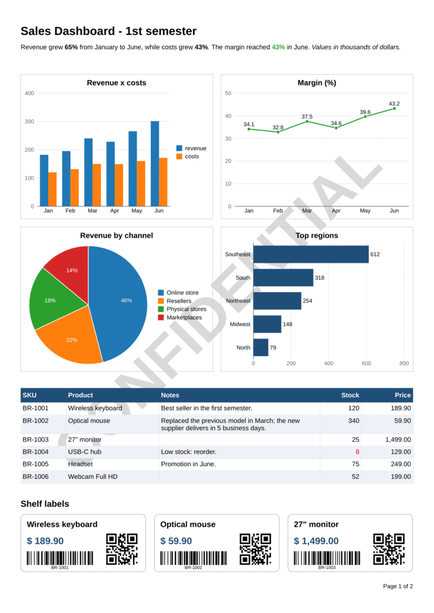
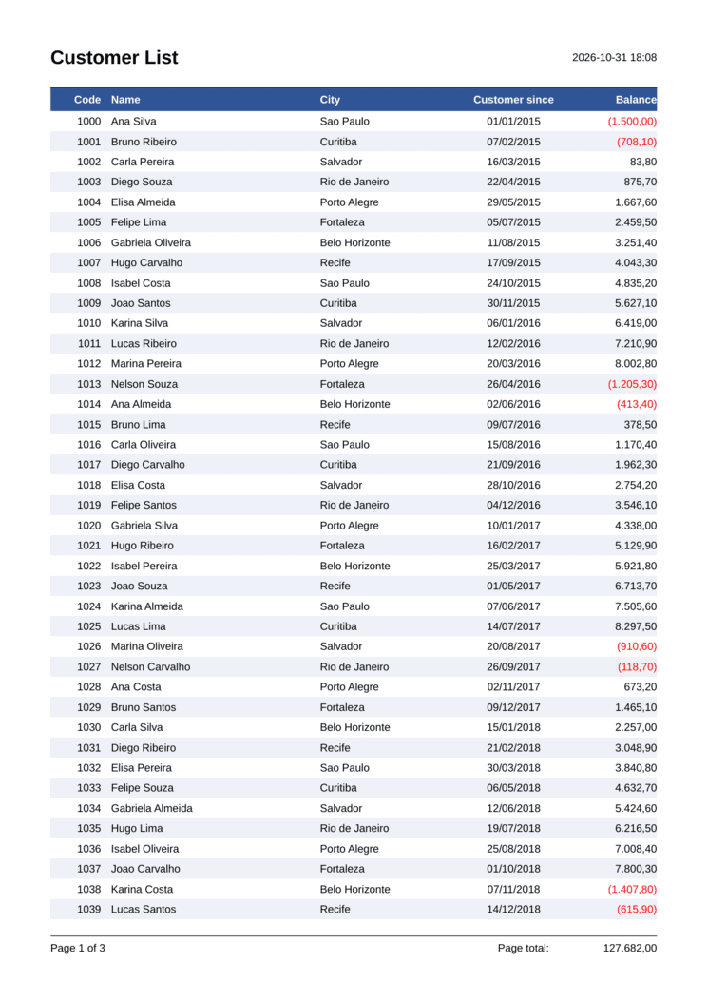
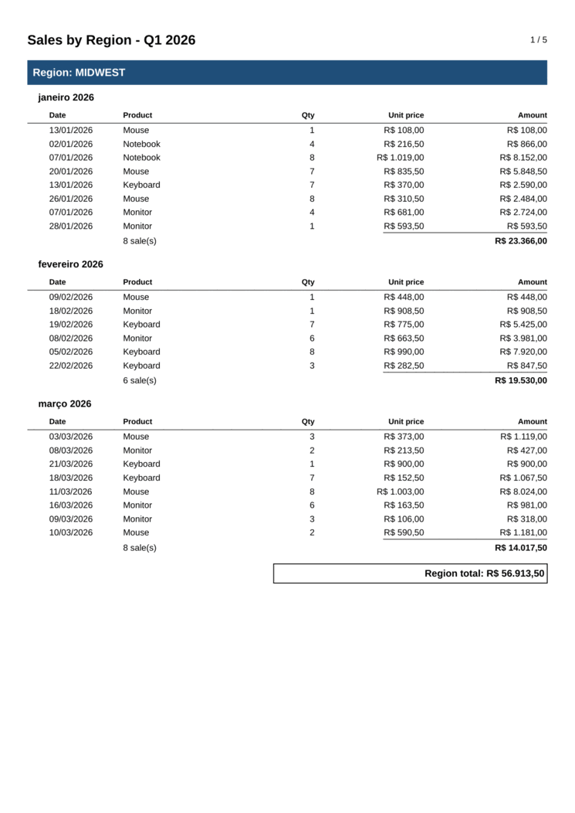
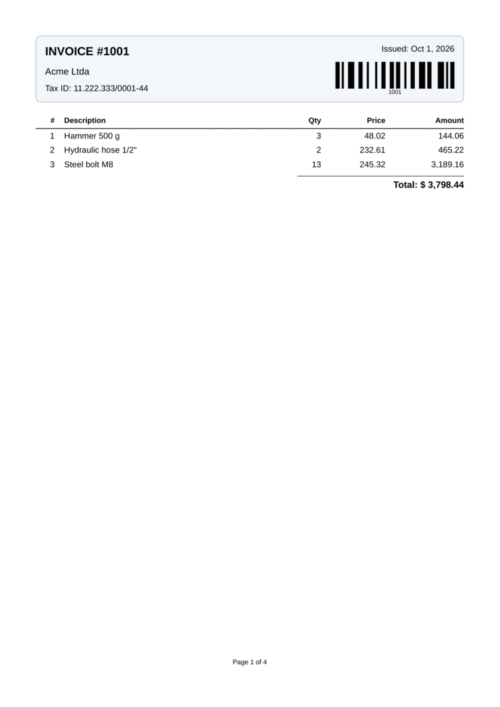
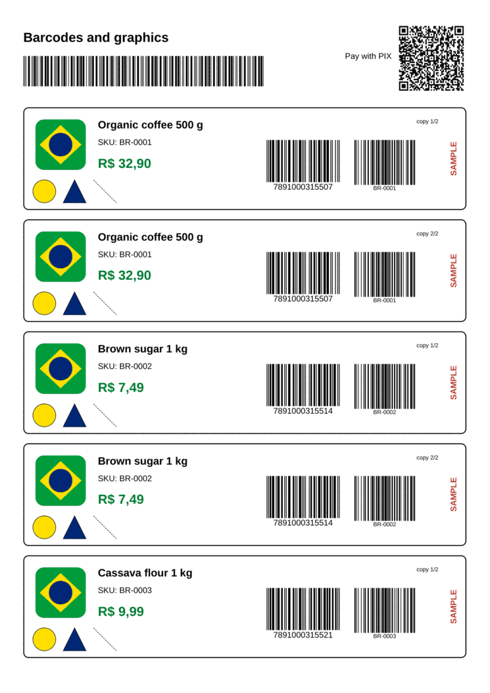
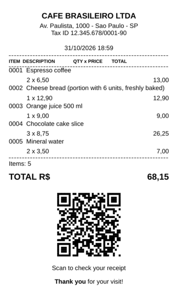
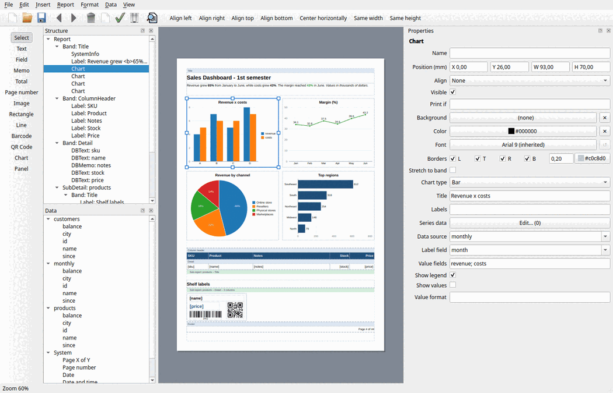

<p align="center">
  
</p>

<p align="center">
  <a href="LICENSE"></a>
  
  
  
  
</p>

## What is BrReport?

**BrReport** is a free and open source report generator for **C++ and Qt**. Reports are built from
**bands**, **groups** and **sub-reports** filled with **objects** (texts, data fields, totals, images,
shapes and barcodes). BrReport takes care of paging, grouping, totals and page numbering, and turns the
result into a document you can **preview**, **print** or **export** to PDF, HTML, SVG, images, XLSX,
RTF and plain text.

It is a native Qt library: no runtime, no scripting engine, no external tools. Use it in desktop
applications with a ready-made preview window, or in console and server programs to generate PDFs.

<p align="center">
  
  
  
</p>
<p align="center">
  
  
  
</p>

## Features

### Report objects

- **Bands**: Header, Title, Column Header, Detail, Column Footer, Summary and Footer.
- **Groups**, nested at any depth, with their own headers, footers and subtotals.
- **Sub-reports** (`BrSubDetail`) for master/detail data such as invoices and their items.
- **Objects**: label, memo, data text, data memo, aggregate result, system info (page *X* of *Y*,
  date, title, record number), image, data image, shapes, panel, rotated text.
- **Rich text**: HTML inside texts (`<b>`, `<i>`, colors, lists, simple tables).
- **Charts**: pie, bars, horizontal bars and lines, from static values or a data source.
- **Barcodes**: QR Code, Data Matrix, PDF417, Code 128, Code 39, EAN-13 and Interleaved 2 of 5.
- **Automatic layout**: page breaks, growing bands for long texts, bands split across pages, objects pushed down by the ones
  that grow above them, cells that stretch to the band height, aligned objects, borders and
  backgrounds.
- **Band options**: zebra rows, multi-column details (labels and cards), group headers kept with
  their first record, bands on the first/last page only, carbon copies and forced page breaks.
- **Page numbering per group**: every invoice (group or sub-report) can show its own "page 1 of 2",
  while the document keeps its overall "sheet 4 of 5".
- **Text options**: shrink the font to fit, hide when empty, word wrap, justification, rotation.
- **Pages**: any paper size and orientation, **continuous pages** for receipt/roll printers, and
  **watermarks** (text or image).
- **Events**: change any object before it prints (colors, text, visibility) with a C++ lambda.

### Data sources

- In-memory lists and JSON-like data (`BrListDataSource`)
- Any Qt model: `QSqlQueryModel`, `QStandardItemModel` or your own (`BrModelDataSource`)
- SQL queries through Qt SQL (`BrSqlDataSource`): SQLite, PostgreSQL, MySQL, ODBC...
- Data on demand through a callback (`BrCallbackDataSource`)
- Your own source: implement six methods of `BrDataSource`

### Report designer

- Visual designer for developers and end users: toolbox, drag fields into bands, move/resize with
  grid snapping, property editor, groups, sub-reports, alignment, copy/paste, undo/redo, preview.
- New report wizard: pick the data and the fields, and get a list report ready to adjust.
- Protected objects: lock parts of a report, so that end users change only the rest.
- Standalone application (`brdesigner`) or a widget to embed in your application
  (`BrDesignerWidget`), saving to files or to your database.

### Report files

- Layouts stored as readable JSON (`.brt`), loaded at run time: change a report without recompiling.
- Data sources referred to by name; conditional printing and highlighting written as formulas.
- SQL queries stored in the report, with parameters from report variables; the application keeps
  the database connections (no passwords in reports).
- Report parameters (text, numbers, dates, yes/no and lists) asked for before preview and print.

### Expressions and formatting

- Formulas in data objects and group keys: `qty * price`, `upper(name)`,
  `if(balance < 0, 'debit', 'credit')`, `formatdate(issued, 'dd/MM/yyyy')`.
- Report variables and your own C++ functions callable from formulas.
- Picture masks for numbers (`#,##0.00`, `'$ '#,##0.00;(#,##0.00)`) and Qt patterns for dates,
  always following the report locale.

### Output

- Vector **PDF** with selectable text
- **HTML** (pages as inline SVG), **SVG**, **PNG/JPEG**
- **Printing** through Qt Print Support, with page ranges
- **Preview window** with navigation, zoom, text search, printing and "save as"
- **`.brp` documents**: save a prepared report and open it later without the data, in your
  application or with the `brview` viewer

## Creating a report

Reports are built in C++ or loaded from **report files** (JSON). All positions and sizes are in
millimeters.

```cpp
#include <brreportwidgets.h>
#include <QApplication>

int main(int argc, char *argv[])
{
    QApplication app(argc, argv);

    BrListDataSource customers({
        {{"name", "Ana Silva"},   {"city", "Sao Paulo"}, {"balance", 1520.75}},
        {{"name", "Bruno Souza"}, {"city", "Curitiba"},  {"balance", -310.00}},
    });

    BrReport report;
    report.setTitle("Customers");
    report.setDataSource(&customers);

    // Page header: printed at the top of every page
    BrBand *header = report.addBand(Br::BandType::Header, 12);
    auto *title = new BrSystemInfo(Br::InfoType::Title, header);
    title->setGeometry(0, 0, 120, 10);             // x, y, width, height in mm
    title->setFont(QFont("Arial", 16, QFont::Bold));

    // Detail: printed once per record
    BrBand *detail = report.addBand(Br::BandType::Detail, 6);
    (new BrDBText("name", detail))->setGeometry(0, 0, 80, 6);
    (new BrDBText("city", detail))->setGeometry(85, 0, 50, 6);
    auto *balance = new BrDBText("balance", detail);
    balance->setGeometry(140, 0, 50, 6);
    balance->setAlignment(Br::TextAlign::Right);
    balance->setDisplayFormat("#,##0.00");

    // Summary: printed once at the end
    BrBand *summary = report.addBand(Br::BandType::Summary, 8);
    auto *total = new BrDBResult("balance", Br::ResultType::Sum, summary);
    total->setGeometry(140, 1, 50, 6);
    total->setAlignment(Br::TextAlign::Right);
    total->setPrefix("Total: ");

    // Page footer: bottom of every page
    BrBand *footer = report.addBand(Br::BandType::Footer, 6);
    auto *page = new BrSystemInfo(Br::InfoType::PagePreview, footer);
    page->setGeometry(0, 0, 190, 6);
    page->setFormat("Page %1 of %2");

    BrPrinting::preview(&report);          // or: report.exportToPdf("customers.pdf");
    return 0;
}
```

### How bands print

| Band | When it prints |
|---|---|
| **Header** | Top of every page |
| **Title** | Once, at the beginning (first page of the report, start of each group) |
| **Column Header** | After Header/Title on every page |
| **Detail** | Once for every record |
| **Column Footer** | After the last record of every page |
| **Summary** | Once, after the last record (end of the report or of each group) |
| **Footer** | Bottom of every page (report), or at the end of each group |

### Groups and totals

```cpp
auto *byRegion = new BrGroup(&report);
byRegion->setDataFields("region");                       // data must be sorted by region

auto *groupHeader = byRegion->addBand(Br::BandType::Header, 8);
auto *name = new BrDBText(groupHeader);
name->setDataFormula("'Region: ' + region");

new BrDBText("product", byRegion->addBand(Br::BandType::Detail, 6));

auto *subtotal = new BrDBResult(byRegion->addBand(Br::BandType::Summary, 8));
subtotal->setDataFormula("qty * price");                 // sum of the group, reset for every region
subtotal->setDisplayFormat("#,##0.00");
```

### Charts

```cpp
auto *chart = new BrChart(Br::ChartType::Bar, band);
chart->setGeometry(0, 0, 190, 70);
chart->setTitle("Revenue x costs");
chart->setDataSource(&monthly, "month", {"revenue", "costs"});   // or setLabels() + addSeries()
```

### Receipts and roll printers

```cpp
report.setPageSizeMm(80, 200);      // paper width; the height grows with the content
report.setContinuous(true);
```

### Page numbers per group

```cpp
auto *invoice = new BrGroup(&report);
invoice->setDataFields("invoice_id");
invoice->setPageBreak(Br::PageBreak::Before);
invoice->setResetPageNumber(true);  // "page 1 of 2" counts the pages of each invoice

auto *page = new BrSystemInfo(Br::InfoType::PagePreview, footer);
page->setFormat("Page %1 of %2");   // Br::InfoType::DocumentPageNumber/DocumentPageCount: whole document
```

### Labels in columns

```cpp
BrBand *card = report.addBand(Br::BandType::Detail, 30);
card->setColumns(3, 4);             // 3 records per row, 4 mm apart
```

### QR Code

```cpp
auto *qr = new BrDBBarcode(Br::BarcodeType::QrCode, "payment_payload", band);
qr->setGeometry(150, 0, 30, 30);
qr->setQrErrorCorrection(Br::QrErrorCorrection::Medium);
```

The QR Code encoder supports versions 1–40, the four error correction levels, numeric,
alphanumeric and UTF-8 modes, and automatic mask selection.

### Report files

The layout can live in a `.brt` file (JSON), so reports can be changed without recompiling the
application. The data stays in the application:

```cpp
BrReport report;
report.addDataSource("customers", &customers);   // any BrDataSource, referred to by name
report.load("customers.brt");
BrPrinting::preview(&report);
```

Any report built in code can be saved with `report.save("customers.brt")`. Behavior that would need
code is expressed with properties: `printIf` and `highlightIf` formulas, zebra rows, and declarative
master/detail links (`masterFields`/`detailFields`). See the
[report file format](docs/report-file-format.md).

### Report designer

<p align="center"></p>

Use the standalone `brdesigner` application, or embed the designer in your application so that
your users can adjust their own reports:

```cpp
auto *designer = new BrDesignerWidget;
designer->addDataSource("customers", &customers);
designer->openFile("customers.brt");             // or loadFromJson() + setSaveHandler() for a database
designer->show();
```

See the [designer guide](docs/designer.md).

## Exporting and printing

```cpp
report.exportToPdf("report.pdf");
report.exportToHtml("report.html");
report.exportToImages("page-%1.png", 150);      // one image per page, 150 dpi
report.exportToXlsx("report.xlsx");             // the text in rows and columns
report.exportToRtf("report.rtf");               // keeps the layout, editable in a word processor
report.exportToText("report.txt");              // for dot-matrix and thermal printers
report.saveDocument("report.brp");              // prepared document, open it later

BrPrinting::preview(&report);                   // preview window (BrReport::Widgets)
BrPrinting::print(&report);                     // system print dialog
```

Prepared documents saved as `.brp` can be opened, printed or converted by the `brview` tool:

```sh
brview report.brp                  # preview window
brview report.brp --pdf report.pdf # convert
```

The core library depends only on QtCore and QtGui, so it also runs on servers without a display:

```sh
QT_QPA_PLATFORM=offscreen ./my-report-service
```

## Translations

The preview window and the designer are available in **English**, **Brazilian Portuguese** and
**Spanish**. The translations are embedded in the libraries; install them once after creating the application:

```cpp
QApplication app(argc, argv);
BrTranslations::install();                                          // system language
// BrTranslations::install(QLocale(QLocale::Portuguese, QLocale::Brazil));
```

`brdesigner` and `brview` use the system language automatically. New languages are welcome: see
[CONTRIBUTING.md](CONTRIBUTING.md#translations).

## Installation

### Requirements

- C++17 compiler (GCC, Clang, MSVC, MinGW)
- CMake 3.16 or newer
- Qt 5.15 or Qt 6: Core and Gui; Widgets and PrintSupport for the preview; Sql for SQL data sources;
  Svg, optional, for SVG images

### Compilation

```sh
git clone <repository-url> brreport
cd brreport
cmake -S . -B build -DCMAKE_PREFIX_PATH=/path/to/Qt/6.x/gcc_64
cmake --build build
ctest --test-dir build
cmake --install build --prefix /usr/local
```

| Option | Default | Description |
|---|---|---|
| `BUILD_SHARED_LIBS` | `ON` | Shared or static libraries |
| `BRREPORT_BUILD_WIDGETS` | `ON` | Preview and printing library |
| `BRREPORT_BUILD_DESIGNER` | `ON` | Report designer library and `brdesigner` |
| `BRREPORT_WITH_SQL` | `ON` | SQL data source (links Qt SQL) |
| `BRREPORT_WITH_SVG` | `ON` | SVG images kept as vectors (links Qt SVG, if found) |
| `BRREPORT_BUILD_EXAMPLES` | `ON` | Example programs |
| `BRREPORT_BUILD_TOOLS` | `ON` | `brview` viewer and `brdesigner` application |
| `BRREPORT_BUILD_TESTS` | `ON` | Unit tests |

### Conan

Recipe in `packaging/conan`, for Conan 2:

```sh
conan create packaging/conan --build=missing
```

- **SVG images are off by default**, because the Qt package of Conan does not include Qt SVG. To use
  them, add `-o "qt/*:qtsvg=True"`. Without it, BrReport builds normally, but SVG images are not drawn.
- PostgreSQL and ODBC drivers of Qt are off too: add `-o "qt/*:with_pq=True"` or
  `-o "qt/*:with_odbc=True"` if you need them.
- If your application already has Qt, do not build it again: declare it in your Conan profile, so
  that there are not two copies of Qt in the same program.

```ini
[platform_requires]
qt/6.12.0
```

### Using BrReport in your project

Installed package:

```cmake
find_package(BrReport REQUIRED)
target_link_libraries(myapp PRIVATE BrReport::Widgets)   # BrReport::Core for headless use,
                                                         # BrReport::Designer for the designer
```

As a sub-project:

```cmake
set(BRREPORT_BUILD_EXAMPLES OFF)
set(BRREPORT_BUILD_TESTS OFF)
add_subdirectory(third-party/brreport)
target_link_libraries(myapp PRIVATE BrReport::Widgets)
```

Then include `<brreportcore.h>`, `<brreportwidgets.h>` or `<brdesignerwidget.h>`.

| Library | Contents | Qt modules |
|---|---|---|
| `BrReport::Core` | Report model, layout engine, data sources, formulas, barcodes, PDF/HTML/SVG/image export | Core, Gui (+ Sql) |
| `BrReport::Widgets` | Preview widget, preview dialog, printing | Widgets, PrintSupport |
| `BrReport::Designer` | Report designer widget | Widgets, PrintSupport |

## Examples

The [`examples`](examples) folder contains complete programs:

| Example | What it shows |
|---|---|
| `quick_start` | The report from this page |
| `hello_world` | Console program that writes a PDF (core library only) |
| `customer_list` | Column headers, striped rows, events, page totals, page *X* of *Y*, summary |
| `grouped_sales` | Nested groups, subtotals, formulas, a page per group, localized formatting |
| `master_detail_sql` | SQLite, sub-report per invoice, barcode, page numbering per invoice |
| `barcodes` | QR Code, Code 128, EAN-13, Interleaved 2 of 5, images, shapes, rotated text, copies |
| `dashboard` | Charts, HTML text, table with stretched cells and zebra rows, labels in columns, watermark |
| `receipt` | 80 mm continuous page for roll printers, wrapped descriptions, totals, QR Code |
| `report_file` | Loads the layout from `customers.brt` and only provides the data |

Every example except `quick_start` also accepts `--save file.brt` to save its layout as a report file.

Every example except `quick_start` opens the preview window, or exports with `--pdf file.pdf`,
`--html file.html`, `--png "page-%1.png"` or `--brp file.brp`.

## Documentation

- [Architecture and print flow](docs/architecture.md)
- [Report file format (.brt)](docs/report-file-format.md)
- [Report designer](docs/designer.md)
- API reference: every public class is documented in its header in [`src/`](src)
- [Changelog](CHANGELOG.md)

## Roadmap

The detailed list of pending work is in [TODO.md](TODO.md).


## Bug reports

Found a problem? Please open an issue with the BrReport and Qt versions, your operating system, and a
small program or a screenshot/PDF that shows the problem.

## Contributing

Contributions are welcome! See [CONTRIBUTING.md](CONTRIBUTING.md).

## License

BrReport is licensed under the [Apache License 2.0](LICENSE). You can use it in open source and
commercial applications.

Copyright © 2026 João Elson.
