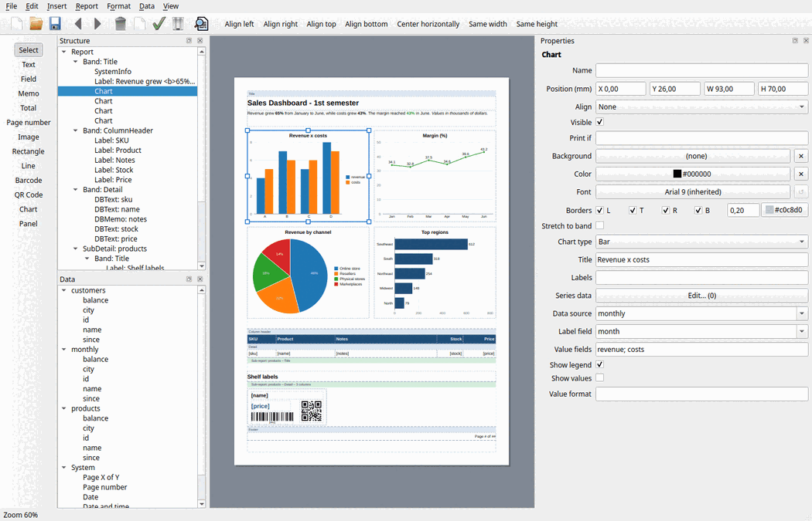

# Report designer

BrReport includes a visual report designer for developers **and end users**. It edits report files
(`.brt`), so a report can be created or changed without recompiling the application.



It is available in two forms:

- **`brdesigner`**, a standalone application (built in `tools/`).
- **`BrDesignerWidget`**, a widget in the `BrReport::Designer` library, to embed the designer in
  your application (an ERP that lets its users adjust their reports, for example).

## What users can do

| Area | Features |
|---|---|
| Page | Paper size, orientation, margins, continuous page, watermark, title, locale |
| Bands | Add Header, Title, Column header, Detail, Column footer, Summary and Footer bands; resize them by dragging the bottom edge; zebra rows, columns, page breaks... in the properties |
| Groups | *Report > Add group*: choose the field; the detail bands move into the group, which gets a header with the field and a summary band |
| Sub-reports | *Report > Add sub-report*: choose the data source, then set the master/detail fields |
| Objects | Toolbox: text, field, memo, total, page number, image, rectangle, line, barcode, QR Code, chart, panel. Click the tool, then click inside a band |
| Fields | Drag fields from the *Data* panel into a band (or double-click them with a band selected) |
| Editing | Move and resize with the mouse (1 mm grid snapping, *View > Snap to grid*), arrow keys (Shift = 5 mm, Alt = 0.1 mm), copy/cut/paste, duplicate (Ctrl+D), delete, change order, align left/right/top/bottom, center, same width/height |
| Properties | Every property of the selected objects, with editors for colors, fonts, borders, images, choices of fields and data sources, formulas (*Print if*, *Highlight if*, *Formula*) |
| Data | SQL queries stored in the report (*Data > Add SQL query*), with parameters taken from report variables (`:name`), and a *Test* button |
| Undo | Unlimited undo/redo (Ctrl+Z / Ctrl+Y) |
| Preview | F5 shows the report with real data |
| Zoom | Ctrl + mouse wheel, Ctrl+0 fits the page to the window |

## Language

The designer is translated into Brazilian Portuguese. Call `BrTranslations::install()` after creating
the `QApplication` to use the system language (`brdesigner` does it automatically).

## Embedding the designer

```cpp
#include <brdesignerwidget.h>

auto *designer = new BrDesignerWidget(parentWindow);

// Data the reports can use: data sources and/or open Qt SQL connections.
designer->addDataSource("customers", customersDataSource);
QSqlDatabase::database();   // the application's default connection, used by SQL queries in reports

designer->openFile("reports/customers.brt");
designer->show();
```

Reports stored in a database instead of files:

```cpp
designer->loadFromJson(loadReportFromDatabase(id));
designer->setSaveHandler([id](const QByteArray &json) {
    return saveReportToDatabase(id, json);     // return false to keep the report marked as modified
});
```

With a save handler, *Save* calls the handler, and *Open* and *Save as* are hidden. The
`modifiedChanged()`, `saved()` and `fileNameChanged()` signals let the application follow the
state, `maybeSave()` asks the user to save pending changes, and `fileMenu()` / `dataMenu()` accept
extra actions.

Printing a designed report in the application:

```cpp
BrReport report;
report.addDataSource("customers", customersDataSource);
report.loadFromJson(loadReportFromDatabase(id));   // or report.load("customers.brt")
report.setVariable("city", selectedCity);          // parameters used by the report's SQL queries
BrPrinting::preview(&report);
```

## Data for end users

End users usually cannot write code, so a report file can carry its own SQL queries:

```json
"queries": [
    { "name": "customers", "connection": "erp",
      "sql": "SELECT * FROM customer WHERE city = :city ORDER BY name" }
]
```

- `connection` is the name of a Qt SQL connection opened by the application (empty = default
  connection). **Passwords are never stored in reports**; the application owns the connections.
- `:city` is bound to the report variable `city`, which the application sets before printing
  (`report.setVariable("city", ...)`) or the user sets in the report properties.
- A data source registered by the application with the same name takes precedence over the query.

The standalone `brdesigner` has *Data > Database connection* to open a connection for designing and
previewing (the password is asked for, never saved).
